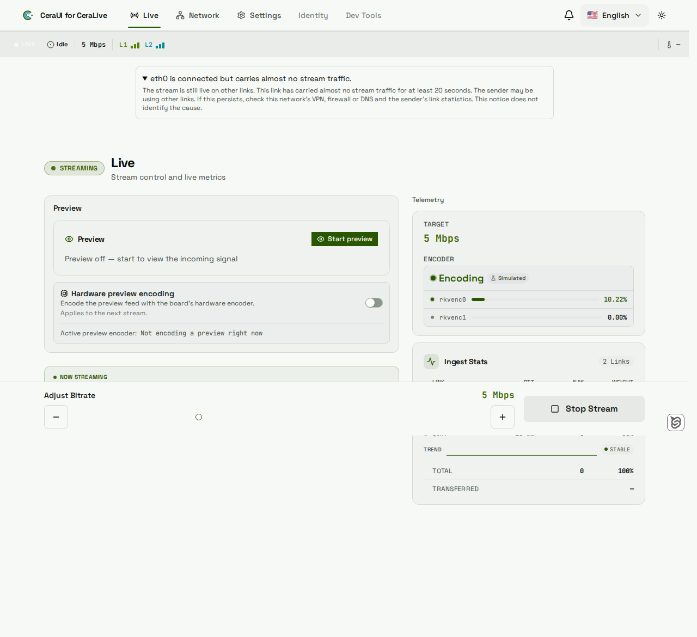
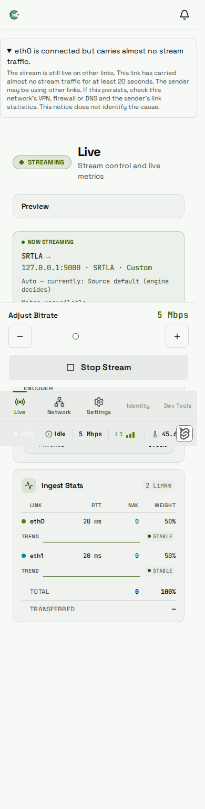

# Connected links carrying almost no stream traffic

During a live stream, Live and Network show a notice for an enabled, connected
bonded link contributing almost no traffic while another eligible link carries
traffic. The shared page content shows the named notice above Live and other destinations;
on Network it appears inside the link's card instead, avoiding duplicate
announcements. Open either notice for details. The stream continues over the
other links. The HUD store owns observations across navigation, so opening
Network does not restart the window. Notices are announced politely and remain
in the page flow.

The detector observes existing sender telemetry only. It requires at least
20 seconds of samples at no more than 1,024 wire bits/s, allowing transport
keepalives. A peer must exceed that threshold throughout the window. At the
backend's 5-second heartbeat with ±10% jitter, onset is normally 20–25 seconds
from the first quiet observation. The sample clock is the backend's fresh-read
time, which may be quantized by its one-second file poll.

An initial hold allows 6.5 seconds between observations: the maximum jittered
heartbeat plus one read period. A shown notice tolerates one missed heartbeat
(up to 12 seconds). This grace does not permit a new notice to start from missing
evidence. Once shown, the notice clears at 2,048 bits/s; the separate recovery
threshold prevents keepalive-sized rate noise from repeatedly hiding it.
Cumulative sent-byte deltas, when available, use the same entry/recovery rates.
Counter rollback, link identity changes, larger gaps, stale or missing bitrate,
disconnect, bond exclusion and stream stop reset the window. Repeated timestamps
cannot advance it. There is no new probe or timer-driven network operation.
Older backends without the observation timestamp show no notice.

RTT, NAK and weight remain visible beside the Network notice. Positive sender
weight means the sender reports the link connected and not timed out; this also
matches the native sender's telemetry projection. A quiet link may reflect the
sender's scheduling rather than a receiver-reachability problem. Zero weight
proves neither deliberate rest nor an unreachable receiver. Both cases therefore
use neutral wording. VPN, firewall or DNS checks are optional troubleshooting
suggestions if the condition persists, rather than a diagnosis.

Session opt-out and heat-ladder spare rest use `isBondOptedOut`, which makes the
backend publish `netif.enabled: false`. `buildBond` removes that interface from
the eligible links; production does not publish a disabled `LinkSignal` for it.
The tests exercise this projection with the carrying peer still present and the
sender row still in telemetry. Compatibility with the heat ladder was checked
against its exclusion path; the notice does not activate or change that policy.

The radio-health “Data path” finding is separate: it reports host Internet-path
probe/registration evidence in modem details. It can coexist with this notice,
which reports sender traffic contribution and does not classify path health.

## Operator copy

English: “{link} is connected but carries almost no stream traffic.” Details
begin: “The stream is still live on other links.”

Español: «{link} está conectado, pero casi no transmite datos del stream».
Los detalles comienzan: «El stream sigue en vivo por otras conexiones».

All ten catalogs carry the notice and details. Publishing the corresponding
English and Spanish user-guide update remains a release coordination step.

## Frozen feeds and intermittent recovery

A one-shot receipt-age latch withdraws the shared claim after 12 seconds without
an advancing backend observation timestamp, even if sensor frames and the socket
remain live. A stale feed cannot establish that a link is still quiet. Clearing
is preferable to adding a second “status unknown” notice: the existing connection
and telemetry surfaces own unknown status. This timer only removes evidence;
it never advances the hold. The next fresh observation starts a new hold.
Per-interface display-age ticks do not create sender observations.

Recovery remains immediate at 2,048 bits/s. A link with a real burst every
30–40 seconds can therefore show and clear once per cycle. This is intentional:
a minimum display time would claim quiet traffic after recovery, while requiring
10 seconds of recovery would hide brief, useful recoveries. The separate rate
thresholds suppress keepalive noise; they do not suppress genuine traffic changes.
Unit tests pin both flap periods and the independent byte-delta thresholds.

The browser smoke check uses a mocked telemetry clock advanced by Playwright,
not real-time waits or a ten-minute click loop. Ten-minute cadence and hysteresis
proof stays in the 200 seeded unit runs. Playwright keeps its default 30-second
per-test budget and CI's two retries; no timeout increase is needed.

## Live page examples (mock data only)

These show the shared notice above the real Live view at 1280 and 390 pixels,
with synthetic sender data and loopback-only test fixtures. The gallery spec
`connected-idle.gallery.visual.spec.ts` recreates both views without starting a sender.

